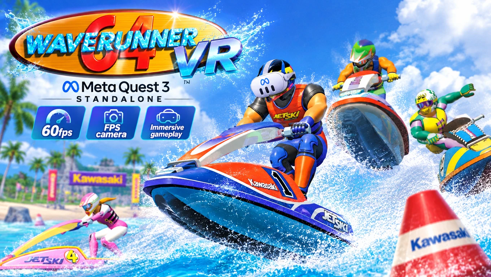

# Wave Runner 64 VR (Meta Quest 3)

Unofficial fan port of Wave Race 64 to Meta Quest 3, running standalone on the headset.

- Look around with your head; the world stays still
- Chase camera or first person (click the right stick)
- Sharp picture (20 fps) or smooth motion (60 fps), chosen at start
- Rumble on the Touch controllers

## Install
1. Download the APK from [Releases](https://github.com/VistaLargaGames/WaveRace64-QuestVR/releases/latest).
2. Install it with SideQuest (or `adb install`).
3. Start it and choose your ROM: Wave Race 64 (USA) (Rev A / v1.1), .z64/.n64/.v64.

**You must own your own copy of Wave Race 64. No game files are included.**

## Controls
Left stick steer/lean · Right trigger or A throttle · Left trigger or B crouch ·
Right grip slide · Left grip Z · Menu button Start · Right stick click first person

## Credits
Built on Wave Race 64: Recompiled, N64Recomp and RT64 (MIT licensed).
Not affiliated with Nintendo, Meta or Kawasaki.
