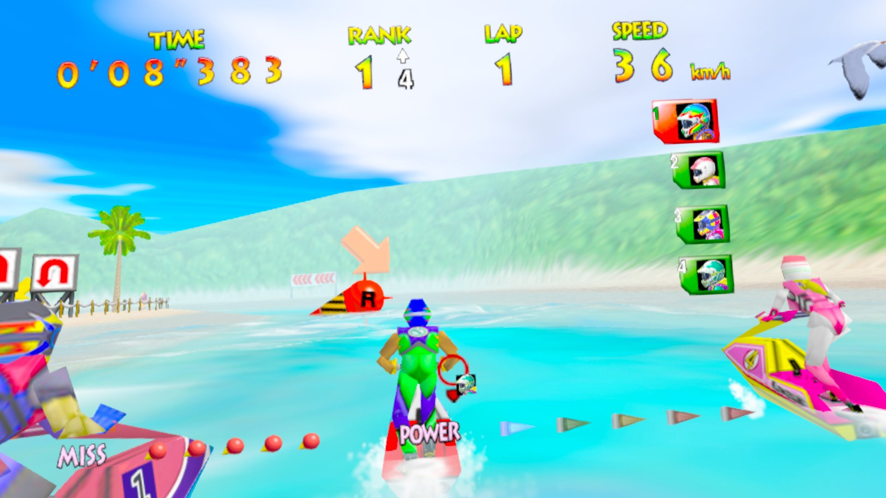
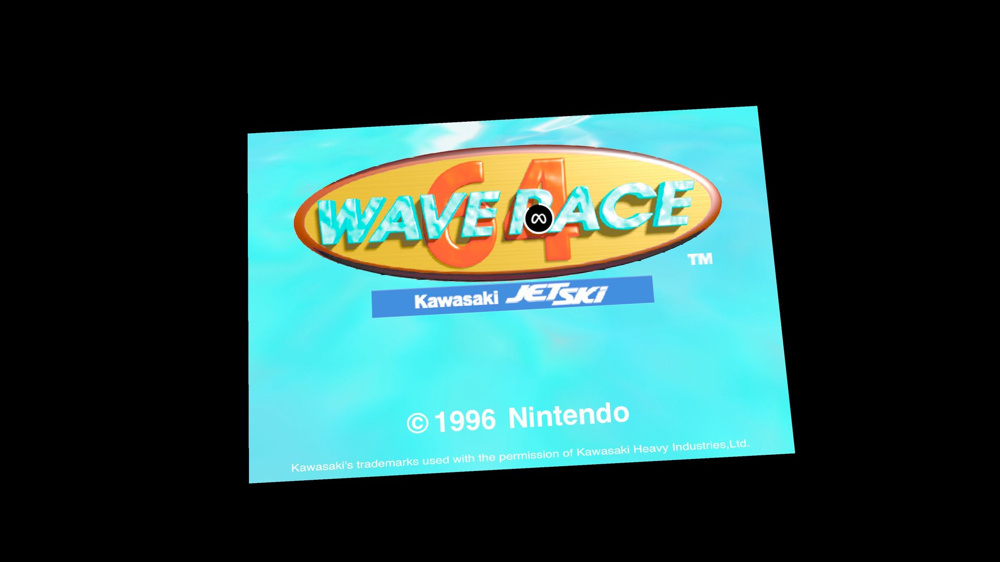
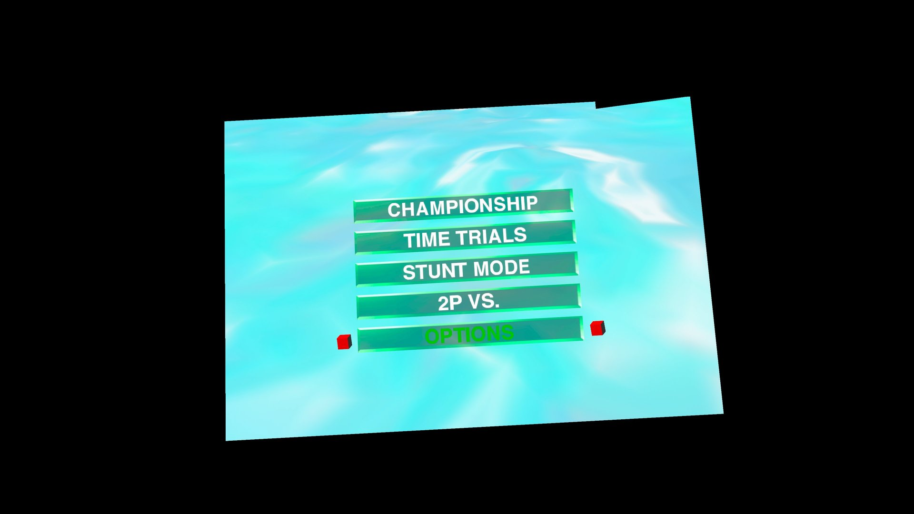

# Wave Runner 64 VR (Meta Quest 3)

Unofficial fan port of Wave Race 64 to Meta Quest 3, running standalone on the headset.

- Look around with your head; the world stays still
- Chase camera or first person (click the right stick)
- Smooth 60 fps with anti-aliasing
- Rumble on the Touch controllers
- Online 2-player races, Quest to Quest, each player full screen
- HD textures: title logo, HUD lettering, signs, jet skis and courses
- HUD on a board in front of you that stays put as you look around

## Screenshots

## Install
1. Download the APK from [Releases](https://github.com/VistaLargaGames/WaveRace64-QuestVR/releases/latest).
2. Install it with SideQuest (or `adb install`).
3. Start it and choose your ROM: Wave Race 64 (USA) (Rev A / v1.1), .z64/.n64/.v64.

**You must own your own copy of Wave Race 64. No game files are included.**

## Online race
1. One player taps **Host** on the start window and gets a 4-digit code.
2. The other taps **Join** and types that code.
3. Each of you rides your own jet ski, full screen in VR.

- Both players need this same version.
- No account needed for either player: online races connect through a
  small free server on Cloudflare.
- Works over the internet; best within the same country.
- Courses come from the host's save. Time Trial and VS only offer courses
  you've reached in Championship mode, so the host should play Championship
  first to unlock more courses.
- 2-player races show less scenery than 1-player races. The original N64
  game draws less in 2-player mode.

## Controls
Left stick steer/lean · Right trigger or A throttle · Left trigger or B crouch ·
Right grip slide · Left grip Z · Menu button Start · Right stick click first person

## Credits
Built on Wave Race 64: Recompiled, N64Recomp and RT64 (MIT licensed).
HD texture pack "nano-banana-2" by Brian Tate (github.com/elliotttate/wave-race-64-recomp); its images adapt Nintendo's original artwork.
Not affiliated with Nintendo, Meta or Kawasaki.
